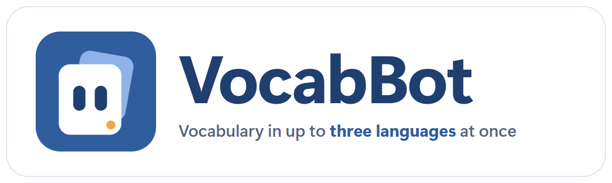

<h1 align="center"></h1>

**English** · [Polski](README.pl.md)

VocabBot teaches vocabulary in one, two or three languages at once: English,
German, Spanish and French, from A1 to B2, for learners whose base language
is Polish. It follows the way the SuperMemo vocabulary courses work: new
words in order of frequency, three grades for every answer, reviews on the
day an algorithm sets, and a drill of the words that went wrong. One engine
serves two ways in: the `vocabbot` program in a terminal, and a plugin for
Claude and Codex that runs the same session in a chat.

## How learning works

- **A day.** Reviews due today come first, then new words, then the drill:
  every card answered wrong comes back at the end of the session until the
  learner knows it. A drill answer leaves the due date unchanged.
- **Cards.** A card shows the Polish meaning, the part of speech and an
  example sentence with a gap; the learner types the word. New words are
  introduced first with their gender, forms, IPA and example.
- **Grades.** The engine compares the typed answer with the entry by the
  rules of the language: right gives "wiem", a small slip (a diacritic, one
  letter, the article, the case, another form of the word) gives "prawie",
  anything else "nie wiem". "Znałem" marks a word the learner knew before
  the course, at its first showing.
- **Schedule.** FSRS-6 sets the next review for a recall of 90% by default,
  the target of the SuperMemo courses. Its results match py-fsrs 6.3.3.
- **Several languages.** New words a day are shared between the languages by
  weight; the languages are interleaved in one session; one concept is not
  introduced in two languages within three days; an answer given in another
  language being learned is recognised and named.
- **Plan.** Languages, levels, weights, new words a day, days off, the target
  recall and the order of languages are settings of a plan. Every change of
  the plan or of the learner's own words is a preview first and is written
  only after the learner's yes.

## Courses

| Language | A1 | A2 | B1 | B2 |
|---|---|---|---|---|
| English | 955 | 1081 | 1743 | 1840 |
| German | 949 | 1087 | 1679 | 1674 |
| Spanish | 947 | 1073 | 1714 | 1728 |
| French | 932 | 1082 | 1708 | 1727 |

The courses are built from open data: the levels from the CEFR-J
Vocabulary Profile, the translations, genders, forms and pronunciation from
Wiktionary (through kaikki.org), the order from wordfreq and the example
sentences with Polish translations from Tatoeba. Claude Sonnet 5.5 reviewed
the meanings and equivalents of all 6600 concepts. In a sample of 1200
entries, 1.2% had a wrong meaning, equivalent or gender. Learners add their
own words from any text.

## Install

The plugin, in Claude Code:

```
/plugin install vocabbot --marketplace dithiothreitol/vocabbot
```

The plugin, in Codex CLI:

```
codex plugin marketplace add dithiothreitol/vocabbot
codex plugin add vocabbot@vocabbot
```

The terminal program, with uv:

```
uv tool install vocabbot
vocabbot init --lang de:a1-a2 --lang es:a1-a2 --new 10
vocabbot drill
```

Python 3.10 or later is the only requirement. [QUICKSTART.md](QUICKSTART.md)
walks through the first week.

The server for chat applications, with accounts for many learners, runs on
your own machine with Docker; Claude on the web and on the phone, ChatGPT,
Claude Code and Codex connect to it as to a remote MCP server.
[docs/server.md](docs/server.md) describes the setup and the connection.

## Documents

- [QUICKSTART.md](QUICKSTART.md): installation, setup and the daily session.
- [plugin/README.md](plugin/README.md) and [plugin/PRIVACY.md](plugin/PRIVACY.md): the plugin and where the data stays.
- [docs/architecture.md](docs/architecture.md): the engine, the guarantees and the checks.
- [docs/development-plan.md](docs/development-plan.md): the staged plan and the results of each stage.
- [docs/pilot.md](docs/pilot.md): the protocol of the pilot before version 1.0.
- [docs/server.md](docs/server.md): the server for chat applications, its accounts and the connection.
- [CHANGELOG.md](CHANGELOG.md): the versions.

## Development

```
uv sync
uv run ruff format --check && uv run ruff check && uv run mypy && uv run pytest
uv run python scripts/build.py skills      # the engine and the rules in every skill
uv run python scripts/validate.py          # repository checks
uv run python scripts/session_test.py --check
```

`CLAUDE.md` describes the layout and the rules for changes;
`tools/courses/` holds the pipeline that builds the courses.

## Licence

The code is licensed under Apache-2.0 ([LICENSE](LICENSE)); the scheduler is
a port of py-fsrs (MIT). The courses are licensed under CC BY-SA 4.0.
[NOTICE](NOTICE) names the sources and their terms.
