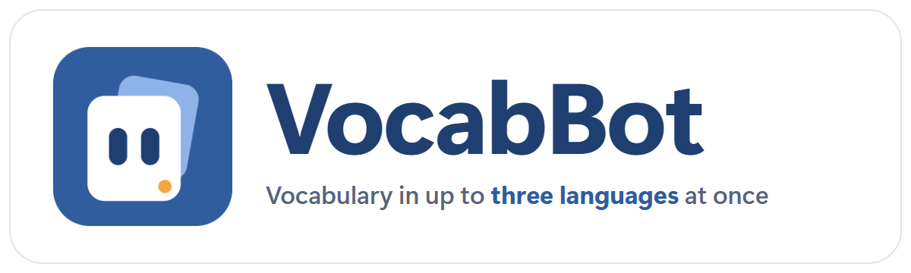

<h1 align="center"></h1>

[English](README.md) · **Polski**

VocabBot uczy słownictwa w jednym, dwóch lub trzech językach równocześnie:
angielskim, niemieckim, hiszpańskim, francuskim i włoskim, od poziomu A1 do B2, dla
osób, których językiem bazowym jest polski. Nauka przebiega tak jak w kursach
słownictwa SuperMemo: nowe słowa według częstości, trzy oceny każdej
odpowiedzi, powtórki w dniu wyznaczonym przez algorytm oraz utrwalanie słów
z błędną odpowiedzią. Jeden silnik obsługuje dwie drogi nauki: program
`vocabbot` w terminalu oraz wtyczkę dla Claude'a i Codexa, która prowadzi tę
samą sesję w czacie.

## Przebieg nauki

- **Dzień.** Dzień ma trzy etapy, tak jak w SuperMemo: powtórki zaplanowane
  na dziś, nowe słowa i utrwalanie, w którym każda karta z błędną
  odpowiedzią wraca aż do odpowiedzi „wiem”. Odpowiedź w utrwalaniu
  zachowuje termin powtórki.
- **Wybór uczącego się.** Uczący się przechodzi między etapami w dowolnej
  chwili: do nowych słów przy czekających powtórkach, z powrotem do powtórek
  oraz do utrwalania. Dzienna liczba nowych słów jest punktem startu
  i kolejne słowa dochodzą do dnia na prośbę, dowolną liczbę razy. Po
  powtórkach zaplanowanych na dziś następna tura podaje karty o najbliższych
  terminach, a algorytm uwzględnia krótszy odstęp w ich następnym terminie.
- **Karty.** Karta pokazuje polskie znaczenie, część mowy i zdanie
  przykładowe z luką, a uczący się wpisuje słowo. Nowe słowo pojawia się
  najpierw z rodzajem, formami, wymową IPA, odnośnikiem do nagrania
  i przykładem. Licznik dnia otwiera każdą wiadomość sesji w czacie.
- **Oceny.** Silnik porównuje wpisaną odpowiedź z hasłem według reguł języka.
  Zgodność daje „wiem”, drobne potknięcie (znak diakrytyczny, jedna litera,
  rodzajnik, wielkość litery, inna forma słowa) daje „prawie”, pozostałe
  odpowiedzi dają „nie wiem”. Ocena „znałem” przy pierwszym pokazaniu
  oznacza słowo znane przed kursem.
- **Harmonogram.** FSRS-6 wyznacza kolejną powtórkę dla trwałości 90%, czyli
  dla wartości stosowanej w kursach SuperMemo. Wyniki zgadzają się
  z biblioteką py-fsrs 6.3.3.
- **Kilka języków.** Silnik dzieli dzienny limit nowych słów między języki
  według wag, przeplata języki w jednej sesji, wprowadza jedno pojęcie
  w dwóch językach w odstępie co najmniej trzech dni i rozpoznaje odpowiedź
  udzieloną w innym z uczonych języków.
- **Plan.** Języki, poziomy, wagi, liczba nowych słów, dni wolne, docelowa
  trwałość i kolejność języków są ustawieniami planu. Każda zmiana planu
  i własnych słów powstaje najpierw jako podgląd i trafia do folderu nauki
  dopiero po potwierdzeniu.

## Kursy

| Język | A1 | A2 | B1 | B2 |
|---|---|---|---|---|
| angielski | 1079 | 1253 | 1919 | 2035 |
| niemiecki | 1016 | 1162 | 1724 | 1747 |
| hiszpański | 1009 | 1126 | 1713 | 1733 |
| francuski | 1004 | 1140 | 1704 | 1731 |
| włoski | 1003 | 1134 | 1681 | 1758 |

Kursy powstały z otwartych danych: poziomy z listy CEFR-J, tłumaczenia,
rodzaj, formy i wymowa z Wikisłownika (przez kaikki.org), kolejność z danych
wordfreq, a zdania przykładowe z polskimi tłumaczeniami z Tatoeby. Claude
Sonnet 5.5 przejrzał znaczenia i odpowiedniki wszystkich 6600 pojęć, a po
dodaniu włoskiego także włoskie odpowiedniki 6700 pojęć. W próbie
1200 haseł błędne znaczenie, odpowiednik lub rodzaj miało 1,2% haseł. Dla
haseł bez zdania w Tatoebie zdanie napisał Claude Sonnet 5.5 i sprawdził je
przegląd przykładów, dzięki czemu przykład ma 99,5% haseł. Odnośnik do
nagrania w Wikimedia Commons (Wikisłownik, Lingua Libre) ma 81,5% haseł, od
98–99% haseł angielskich do 27–79% haseł włoskich. Własne słowa z dowolnego
tekstu uzupełniają kurs.

## Instalacja

Wtyczka w Claude Code:

```
/plugin install vocabbot --marketplace dithiothreitol/vocabbot
```

Wtyczka w Codex CLI:

```
codex plugin marketplace add dithiothreitol/vocabbot
codex plugin add vocabbot@vocabbot
```

Program w terminalu, przez uv:

```
uv tool install vocabbot
vocabbot init --lang de:a1-a2 --lang es:a1-a2 --new 10
vocabbot drill
```

Jedynym wymaganiem jest Python 3.10 lub nowszy. [QUICKSTART.pl.md](QUICKSTART.pl.md)
prowadzi przez pierwszy tydzień nauki.

Serwer dla aplikacji czatu, z kontami dla wielu uczących się, działa na
Twojej maszynie w Dockerze, a Claude w przeglądarce i w telefonie, ChatGPT,
Claude Code oraz Codex łączą się z nim jak ze zdalnym serwerem MCP.
W Claude i ChatGPT sesja pokazuje też kartę z licznikiem dnia i przyciskiem,
który odtwarza nagranie słowa. [docs/server.pl.md](docs/server.pl.md) opisuje
uruchomienie i podłączenie.

## Dokumenty

- [QUICKSTART.pl.md](QUICKSTART.pl.md): instalacja, konfiguracja i codzienna sesja.
- [plugin/README.pl.md](plugin/README.pl.md) i [plugin/PRIVACY.pl.md](plugin/PRIVACY.pl.md): wtyczka i miejsce przechowywania danych.
- [docs/architecture.md](docs/architecture.md): silnik, gwarancje i kontrole (po angielsku).
- [docs/development-plan.pl.md](docs/development-plan.pl.md): plan etapów i ich wyniki.
- [docs/pilot.pl.md](docs/pilot.pl.md): protokół pilotażu przed wersją 1.0.
- [docs/server.pl.md](docs/server.pl.md): serwer dla aplikacji czatu, jego konta i podłączenie.
- [CHANGELOG.md](CHANGELOG.md): wersje (po angielsku).

## Rozwój

```
uv sync
uv run ruff format --check && uv run ruff check && uv run mypy && uv run pytest
uv run python scripts/build.py skills      # silnik i reguły w każdej umiejętności
uv run python scripts/validate.py          # kontrole repozytorium
uv run python scripts/session_test.py --check
```

Plik `CLAUDE.md` opisuje układ repozytorium i zasady zmian, a katalog
`tools/courses/` zawiera potok budowy kursów.

## Licencja

Kod jest udostępniony na licencji Apache-2.0 ([LICENSE](LICENSE)), przy czym
harmonogram jest przeniesieniem biblioteki py-fsrs (MIT). Kursy mają licencję
CC BY-SA 4.0. Plik [NOTICE](NOTICE) wymienia źródła i ich warunki.
